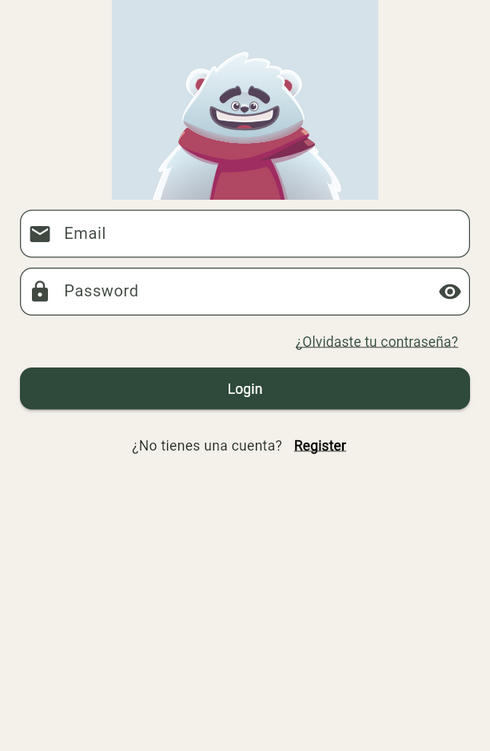
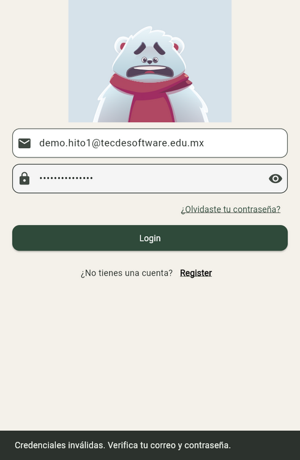
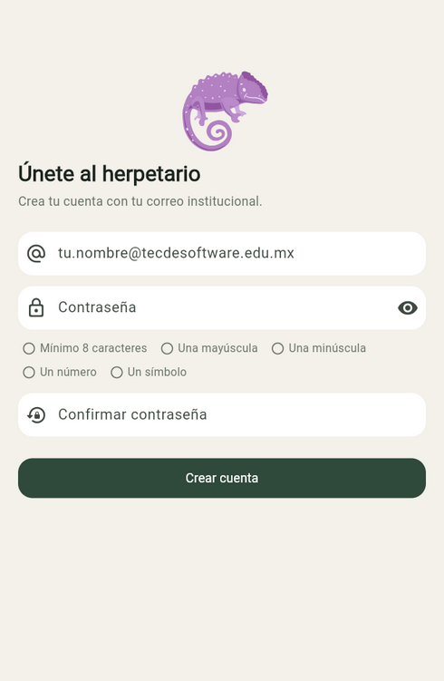
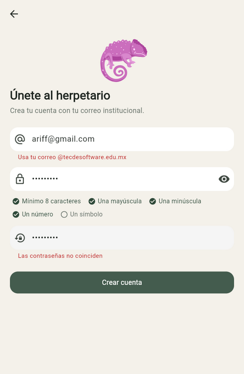
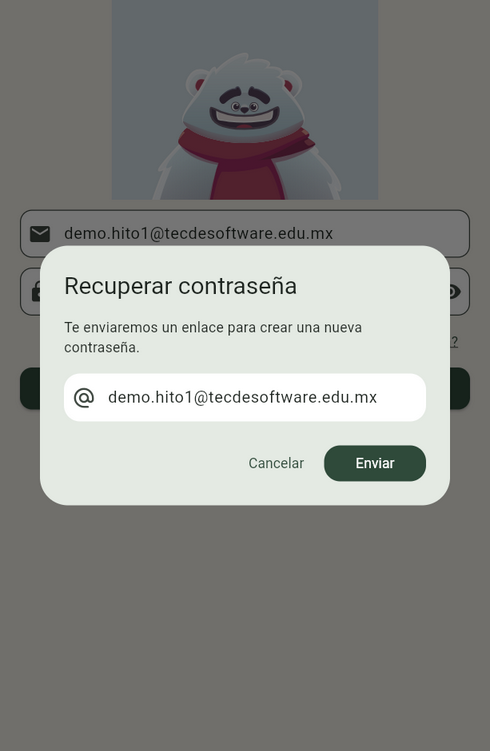
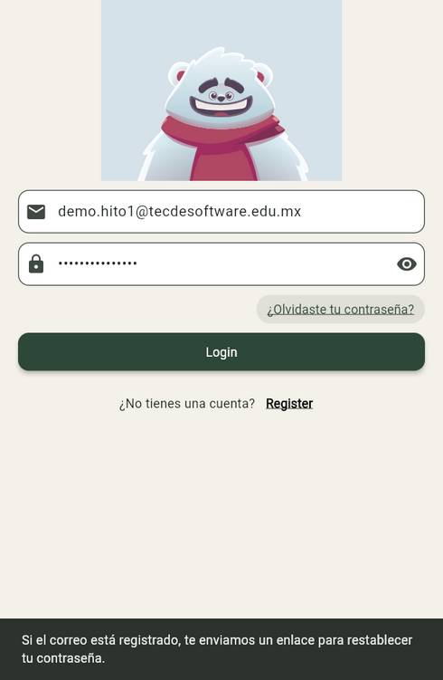
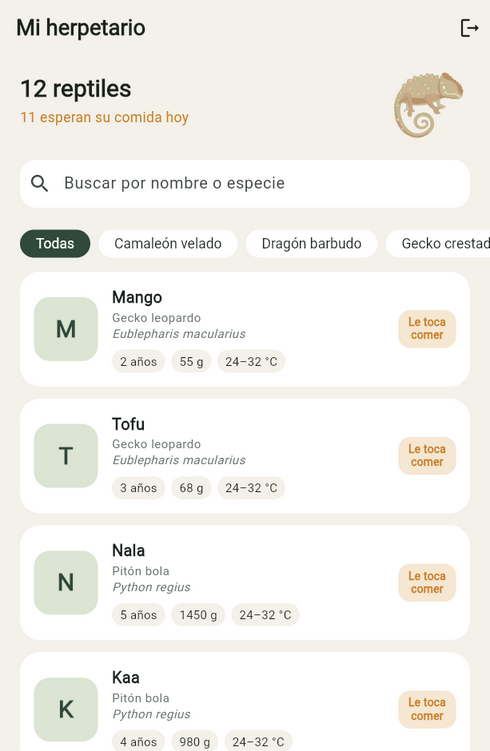
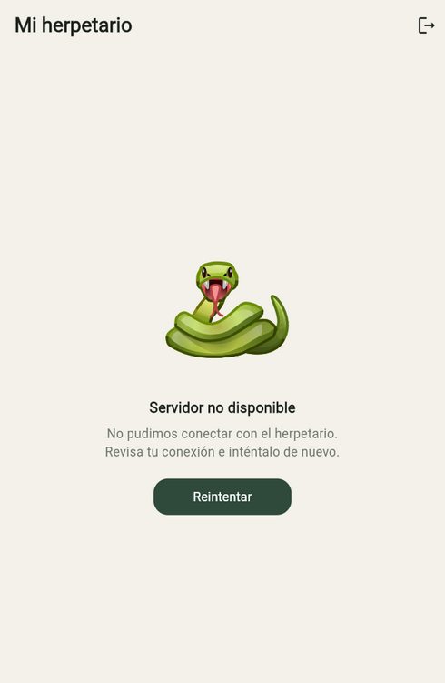

# 🦎 Herpetario — App móvil

App en **Flutter** para llevar el control de tus reptiles: especie, edad, peso, requisitos de temperatura y humedad, y aviso de cuándo **le toca comer** a cada uno. La autenticación usa **Firebase Auth** y los datos vienen de una API en **Spring Boot + PostgreSQL**.

| Repositorio | Enlace |
|---|---|
| App móvil (este repo) | https://github.com/AriffMedina/Mobile-Bear-Login |
| Backend Spring Boot | https://github.com/AriffMedina/herpetario-backend |

> **Temática:** el cambio de *market* a *herpetario* fue autorizado por escrito por el profesor.

---

## Hito 1 — Identidad segura y conexión con el backend

| Criterio | Pts | Estado |
|---|:-:|:-:|
| Login seguro según OWASP (mensaje global, animaciones, loading, navegación) | 5 | ✅ |
| Registro con validaciones y registro real en Firebase | 6 | ✅ |
| Recuperación de contraseña y cierre de sesión | 4 | ✅ |
| Temática en Spring Boot (10+ registros) mostrando categoría | 3 | ✅ |
| Credenciales fuera de GitHub (`.gitignore`) | 2 | ✅ |

### A. Login seguro (OWASP)

  
  

- Se quitaron los `errorText` por campo y la validación con regex. Solo se valida que los campos no estén vacíos.
- Cualquier fallo de Firebase muestra **un único mensaje**: *"Credenciales inválidas. Verifica tu correo y contraseña."*, junto con la animación `trigFail` del oso. Así no se revela si el correo existe (enumeración de cuentas, OWASP A07).
- Se conserva el flujo de éxito: `CircularProgressIndicator`, `trigSuccess` con su espera y `Navigator.pushReplacement`.
- La captura del error es una respuesta **real** de Firebase con un correo inexistente.

### B. Registro

  
  

- `SignUpScreen` se abre con `Navigator.push` desde "Register", así que se puede regresar al login.
- Correo **institucional obligatorio** (`@tecdesoftware.edu.mx`).
- Las reglas de contraseña están **visibles y se marcan en vivo**: mínimo 8 caracteres, mayúscula, minúscula, número y símbolo. También se pide confirmar la contraseña.
- `createUserWithEmailAndPassword(...)`. Al terminar, avisa al usuario y regresa al login.
- Aquí sí hay mensajes específicos por `e.code` (`email-already-in-use`, `weak-password`…). Solo el login es genérico.

### C. Recuperar contraseña y cerrar sesión

  
  

- "¿Olvidaste tu contraseña?" abre un `Dialog` con el correo ya escrito y llama a `sendPasswordResetEmail(email: ...)`.
- La confirmación es **neutra**: *"Si el correo está registrado, te enviamos un enlace…"*. Con esto el formulario tampoco permite enumerar cuentas.
- El botón de **cerrar sesión** está en el `AppBar` del catálogo (ver la captura de la sección D). Llama a `FirebaseAuth.instance.signOut()` y regresa a `LoginScreen`.

### D. Temática en Spring Boot

  
  

- La base de datos tiene **12 reptiles de 6 especies** ([`herpetario.sql`](https://github.com/AriffMedina/herpetario-backend/blob/master/src/main/resources/db/herpetario.sql)). La **especie** es la categoría de cada registro.
- Cada tarjeta muestra el nombre, la especie (común y científica), la edad, el peso, el rango de temperatura y el aviso de alimentación, que se calcula con la frecuencia de su especie.
- Hay búsqueda por nombre o especie y chips para filtrar por especie.
- Adelanto del Hito 2: si el servidor no responde, aparece la vista **"Servidor no disponible"** con el botón **Reintentar**.

### Credenciales fuera de GitHub

| Repo | Archivo ignorado |
|---|---|
| App | `lib/firebase_options.dart`, `google-services.json`, `GoogleService-Info.plist` |
| Backend | `application-dev.properties`, con `application-dev.properties.example` como plantilla |

---

## Commits del Hito 1

**App móvil**
- 23/11 — [`a05bcc1`](https://github.com/AriffMedina/Mobile-Bear-Login/commit/a05bcc1a6592bf9882012cff0a47c834e5f5245a) feat(auth): sign in with Firebase Auth and load products from Spring Boot
- 24/11 — [`825c1a6`](https://github.com/AriffMedina/Mobile-Bear-Login/commit/825c1a6c7767ed685c86d29eafee4e2fbacf2198) feat(ui): herpetarium home with species filters and Lottie states
- 24/11 — [`f5eb98e`](https://github.com/AriffMedina/Mobile-Bear-Login/commit/f5eb98e03d250406f0be495bd1364f9697765b85) fix(login): replace per-field validation with a single generic error (OWASP)
- 24/11 — [`00b15d1`](https://github.com/AriffMedina/Mobile-Bear-Login/commit/00b15d13346a33726923f469538467737c4d8fff) feat(auth): add sign-up screen with institutional email and password rules
- 24/11 — [`57f5f55`](https://github.com/AriffMedina/Mobile-Bear-Login/commit/57f5f55173597f36977ead009aafe0481e81382c) feat(auth): add password reset dialog to login

**Backend**
- 23/11 — [`945ce7f`](https://github.com/AriffMedina/herpetario-backend/commit/945ce7fa1c30f2aef22e318e8f2625eab5d351d2) chore(web): add global CORS config for the Flutter client
- 23/11 — [`e76f0a2`](https://github.com/AriffMedina/herpetario-backend/commit/e76f0a23df5c433cea94a2cff55a8227b6a7965c) feat(herpetarium): replace market domain with species and reptiles API
- 23/11 — [`958f1eb`](https://github.com/AriffMedina/herpetario-backend/commit/958f1ebcc2e3411276d9919a333c5ec470d4e146) chore(config): stop tracking dev DB credentials and add example file
- 23/11 — [`80d4fa9`](https://github.com/AriffMedina/herpetario-backend/commit/80d4fa9c6aad0d73c016925597eb3c40ed3d8a8b) refactor: rename project and package to herpetario

El historial completo, con commits desde octubre, está en [la lista de commits](https://github.com/AriffMedina/Mobile-Bear-Login/commits/main).

---

## Cómo ejecutarlo

1. **Backend.** En `herpetario-backend`, copia `application-dev.properties.example` como `application-dev.properties` y llénalo con tus datos. Corre `herpetario.sql` en PostgreSQL y después `./gradlew bootRun`. Queda en el puerto `8090`.
2. **App.** Agrega tu `lib/firebase_options.dart` y ajusta `baseUrl` en `lib/services/herpetario_api.dart`:
   - Celular físico: `http://IP_DE_TU_PC:8090`
   - Emulador Android: `http://10.0.2.2:8090`
3. Corre `flutter pub get` y luego `flutter run`.

**Pruebas:** `flutter test` ejecuta 14 pruebas. Cubren el modelo (parseo con acentos, cálculo de alimentación y edad) y los validadores del registro (dominio institucional, reglas de contraseña y mensajes de error).

---

> **Sobre las capturas:** se tomaron de la versión web en un viewport de tamaño móvil. La demostración en dispositivo móvil está en el video entregado en Teams.
>
> **Animaciones:** Lottie de [LottieFiles](https://lottiefiles.com) bajo la Lottie Simple License, de TheSub, iKAR, SM Rony y Tarryn Myburgh. El oso del login es una animación Rive.
